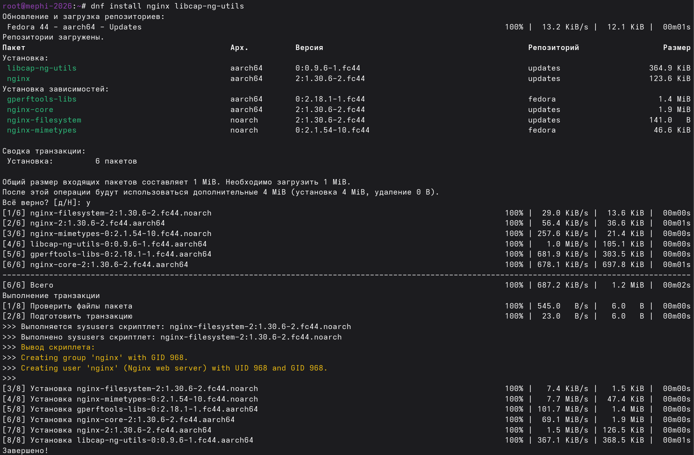
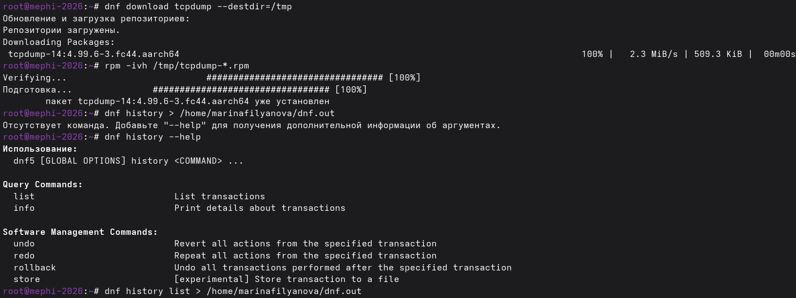
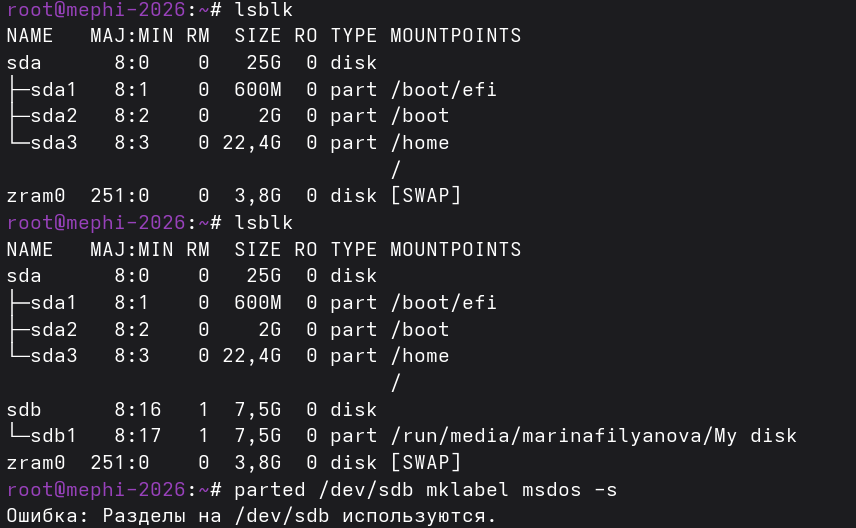
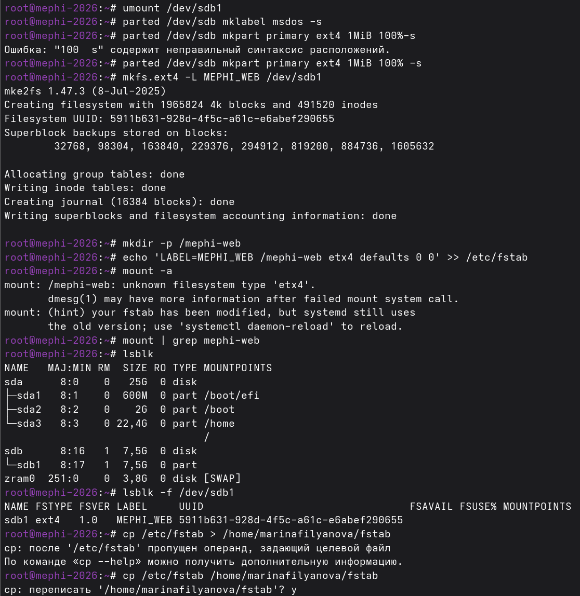
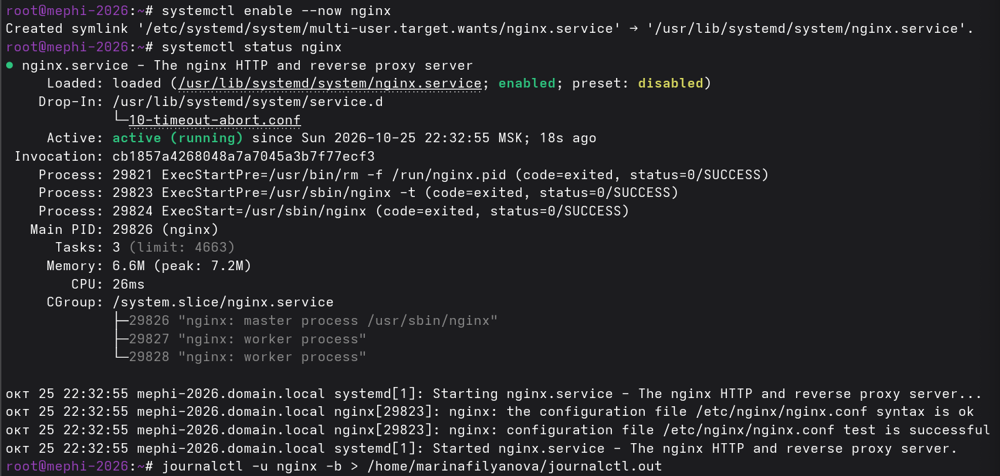
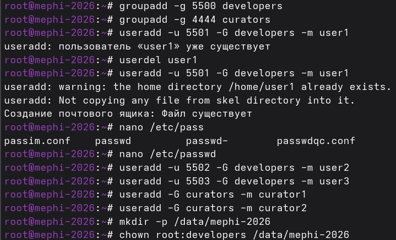
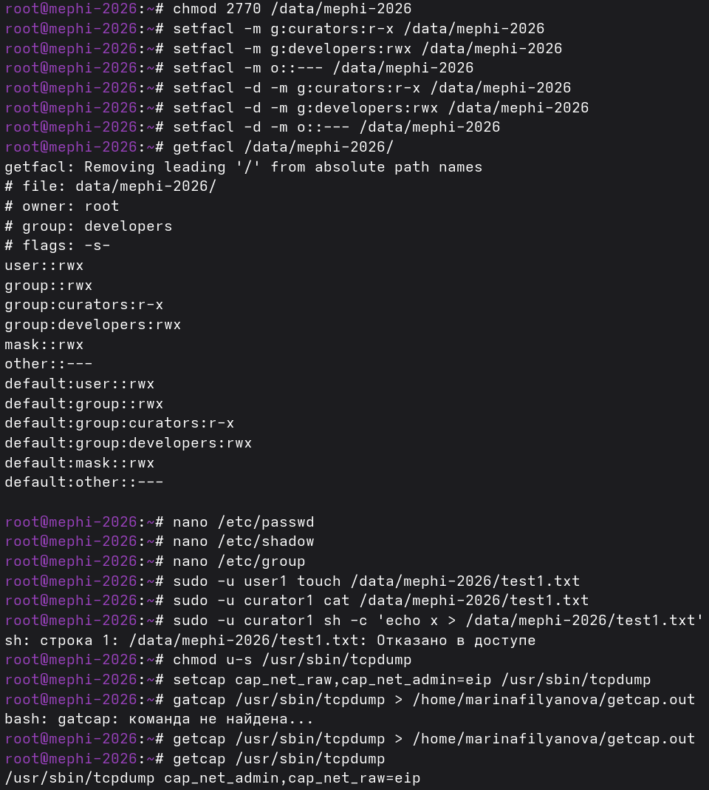
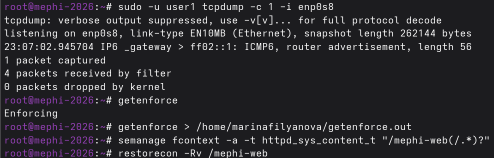
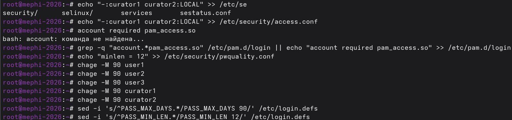
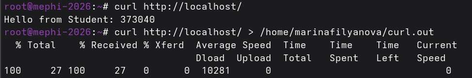

# Сессионный проект по курсу “Безопасность GNU/Linux”: Настройка базовых средств защиты ОС GNU/Linux

**Студент:** *Филянова Марина Андреевна*  
**Уникальный номер (шифр):** *373040*  
**Операционная система:** *Fedora Linux (версия 44)*  

## Описание выполненных работ

Ниже приведено пошаговое описание выполнения каждого раздела задания с использованием стандартных POSIX-команд в терминале. 

### Раздел 1. Установка дистрибутива
```bash
# Настройка сетевого подключения
nmcli connection modify "Проводное подключение 1" ipv4.method auto ipv4.addresses "" ipv4.gateway "" ipv4.dns ""

# Применение новых сетевых настроек
nmcli connection up "Проводное подключение 1"

# Настройка имени хоста
hostnamectl set-hostname mephi-2026.domain.local

# Сохранение артефактов
ping -c 4 8.8.8.8 > /home/marinafilyanova/ping.out
```
### Раздел 2. Управление программным обеспечением
```bash
# Обновление пакетов
dnf update

# Установка веб-сервера nginx и утилиты libcap-ng-utils
dnf install nginx libcap-ng-utils

# Скачивание RPM-пакета tcpdump
dnf download tcpdump --destdir=/tmp

# Установка RPM-пакета в систему
rpm -ivh /tmp/tcpdump-*.rpm

# Сохранение артефактов
dnf history list > /home/marinafilyanova/dnf.out
```
#### Подтверждение выполнения



### Раздел 3. Управление файловыми системами
```bash
# Просмотр блочных устройств
lsblk

# Создание новой таблицы разделов MBR
parted /dev/sdb mklabel msdos -s

# Создание первичного раздела с файловой системой ext4
parted /dev/sdb mkpart primary ext4 1MiB 100% -s

# Форматирование раздела и задание метки тома
mkfs.ext4 -L MEPHI_WEB /dev/sdb1

# Создание точки монтировния
mkdir -p /mephi-web

# Добавление в /etc/fstab правила автоматического монтирования раздела по метке MEPHI_WEB.
echo 'LABEL=MEPHI_WEB /mephi-web etx4 defaults 0 0' >> /etc/fstab

# Монтирование файловых систем
mount -a

# Проверка что раздел смотнирован
mount | grep mephi-web

# Сохранение артефактов
cp /etc/fstab /home/marinafilyanova/fstab
```
#### Подтверждение выполнения



### Раздел 4. Управление сервисами
```bash
# Включение автозапуска nginx при загрузке системы
systemctl enable --now nginx

# Просмотр текущего состояния сервиса nginx
systemctl status nginx

# Сохранение артефактов
journalctl -u nginx -b > /home/marinafilyanova/journalctl.out
```
#### Подтверждение выполнения


### Раздел 5. Управление доступом
```bash
# Создание новых групп
groupadd -g 5500 developers
groupadd -g 4444 curators

# Создание новых пользователей
useradd -u 5502 -G developers -m user2
useradd -u 5503 -G developers -m user3
useradd -G curators -m curator1
useradd -G curators -m curator2

# Создание каталога
mkdir -p /data/mephi-2026

# Назначение владельцем каталога root, а группой-владельцем — developers
chown root:developers /data/mephi-2026

# Установка прав
chmod 2770 /data/mephi-2026

# Настройка ACL
setfacl -m g:curators:r-x /data/mephi-2026
setfacl -m g:developers:rwx /data/mephi-2026
setfacl -m o::--- /data/mephi-2026

# Настройка default ACL
setfacl -d -m g:curators:r-x /data/mephi-2026
setfacl -d -m g:developers:rwx /data/mephi-2026
setfacl -d -m o::--- /data/mephi-2026

# Просмотр действующего ACL каталога проекта
getfacl /data/mephi-2026/

# Проверка работы ACL
sudo -u user1 touch /data/mephi-2026/test1.txt
sudo -u curator1 cat /data/mephi-2026/test1.txt
sudo -u curator1 sh -c 'echo x > /data/mephi-2026/test1.txt'

# Удаление бита setuid
chmod u-s /usr/sbin/tcpdump

# Выдача привилегий для захвата пакетов
setcap cap_net_raw,cap_net_admin=eip /usr/sbin/tcpdump

# Сохранение артефактов
getcap /usr/sbin/tcpdump > /home/marinafilyanova/getcap.out

# Проверка от имени user1
sudo -u user1 tcpdump -c 1 -i enp0s8

# Проверка текущего режима SELinux
getenforce

# Сохранение артефактов
getenforce > /home/marinafilyanova/getenforce.out

# Создание постоянного правила SELinux
semanage fcontext -a -t httpd_sys_content_t "/mephi-web(/.*)?"

# Применение правила контекста SELinux 
restorecon -Rv /mephi-web
```
#### Подтверждение выполнения




### Раздел 6. Аутентификация
```bash
# Добавление правила PAM access
echo "-:curator1 curator2:LOCAL" >> /etc/security/access.conf

# Добавление строки подключения модуля pam_access
grep -q "account.*pam_access.so" /etc/pam.d/login || echo "account required pam_access.so" >> /etc/pam.d/login

# Установка минимальной длины пароля 12 символов в политике качества паролей
echo "minlen = 12" >> /etc/security/pwquality.conf

# Установка для пользователей максимальный срок действия пароля
chage -M 90 user1
chage -M 90 user2
chage -M 90 user3
chage -M 90 curator1
chage -M 90 curator2

# Установка срок действия и минимальной длины пароля по умолчанию для новых пользователей
sed -i 's/^PASS_MAX_DAYS.*/PASS_MAX_DAYS 90/' /etc/login.defs
sed -i 's/^PASS_MIN_LEN.*/PASS_MIN_LEN 12/' /etc/login.defs 
```
#### Подтверждение выполнения


### Раздел 7. Тестирование
```bash
# Создание файла index.html в корне веб-каталога
echo "Hello from Student: 373040" > /mephi-web/index.html

# Вывод содержимого главной страницы
curl http://localhost/

# Сохранение артефактов
curl http://localhost/ > /home/marinafilyanova/curl.out
history > /home/marinafilyanova/history.out
```
#### Подтверждение выполнения


## Описание артефактов (файлов в репозитории)

| Файл | Раздел | Что проверяется / Содержимое |
|------|--------|------------------------------|
| `mephi-screenshot.png` | 8 | Скриншот терминала с видимым уникальным номером зачетной книжки. |
| `history.out` | Все | История выполненных команд в терминале (под правами root). |
| `history2.out` | Все | История выполненных команд в терминале (под правами пользователя). |
| `ping.out` | 1 | Проверка сетевой связности. |
| `dnf.out` | 2 | История транзакций менеджера пакетов. |
| `stat.out` | |  |
| `journalctl.out` | 4 | Журнальные сообщения сервиса nginx. |
| `getcap.out` | 5 | Список capabilities файла tcpdump. |
| `getenforce.out` | 5 | Текущий режим SELinux. |
| `curl.out` | | |
| `fstab` | 3 | Содержимое файла /etc/fstab.|
| `passwd` | | |
| `shadow` | | |
| `group` | | |
| `pwquality.conf` | | |
